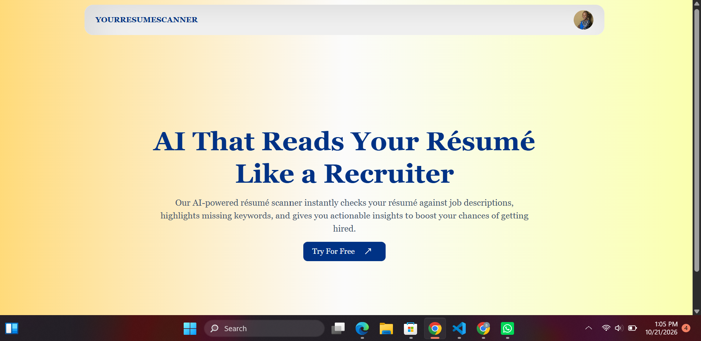

# YourResumeScanner

> An AI-powered résumé scanner that instantly checks your résumé against job descriptions, and gives you actionable insights to boost your chances of getting hired.

[Live Demo](http://resume-scanner.clouddeploy.name.ng)

## 📋 Table of Contents

- [About The Project](#-about-the-project)
- [Features](#-features)
- [Built With](#️-built-with)
- [Infrastructure & DevOps](#️-infrastructure--devops)
- [Getting Started](#-getting-started)
  - [Prerequisites](#prerequisites)
  - [Installation](#installation)
  - [Environment Variables](#environment-variables)
- [Usage](#-usage)
- [Roadmap](#️-roadmap)
- [License](#-license)
- [Acknowledgments](#-acknowledgments)

## 🎯 About The Project



**YourResumeScanner** is an AI-powered resume analyzer that analyses resumes against specific job descriptions, providing instant, actionable feedback. 

What started as a frontend passion project has now evolved into a fully containerized, production-grade application featuring a complete CI/CD pipeline and AWS cloud infrastructure.

## ✨ Features

- 🚀 **Lightning-Fast Responses** - Powered by Groq's ultra-fast inference
- 🎨 **Modern UI/UX** - Clean, responsive design with smooth animations
- 📱 **Mobile Optimized** - Seamless experience across all devices
- 📊 **Rich Formatting** - Beautiful markdown rendering with tables and lists
- 🔐 **Secure Authentication** - Google OAuth integration via NextAuth
- ♿ **Accessible** - Built with accessibility best practices
- ⚙️ **Fully Automated CI/CD** - Zero-downtime deployments triggered by GitHub pushes
- ☁️ **Infrastructure as Code** - AWS resources provisioned natively via Terraform

## 🛠️ Built With

### Core Technologies
- **[Next.js 15](https://nextjs.org/)** - React framework with App Router
- **[React 18](https://reactjs.org/)** - UI library
- **[TypeScript](https://www.typescriptlang.org/)** - Type Safety
- **[Tailwind CSS](https://tailwindcss.com/)** - Utility-first styling
- **[ShadCN/UI](https://ui.shadcn.com/)** - UI Library

### Backend & Database
- **[Neon (PostgreSQL)](https://neon.tech/)** - Serverless relational database
- **[Drizzle](https://orm.drizzle.team/docs/overview)** - Database ORM
- **[Groq API](https://groq.com/)** - AI language model (Llama 3.3 70B)
- **[NextAuth.js](https://next-auth.js.org/)** - Authentication

## ☁️ Infrastructure & DevOps

This project isn't just deployed; it's fully engineered for the cloud using modern DevOps principles:

- **🐳 Docker:** The application is containerized using multi-stage Docker builds to ensure a lightweight, secure production image.
- **🏗️ Terraform (IaC):** All AWS infrastructure is provisioned via code, including ECS Fargate, ECR, IAM roles, CloudWatch, and Security Groups.
- **🚀 GitHub Actions (CI/CD):** Fully automated pipeline. When code is pushed to `main`, GitHub Actions securely authenticates with AWS (using OIDC), builds the image, pushes it to ECR, and forces a zero-downtime deployment to ECS.
- **⚖️ AWS Application Load Balancer (ALB):** Routes public traffic securely to the ECS Fargate tasks, handling health checks and target group routing.
- **📊 AWS CloudWatch:** Centralized logging for all container activity.

## 🚀 Getting Started

### Prerequisites

Ensure you have the following installed:

```bash
# Node.js v18 or higher
node --version  # Should be >= 18.0.0

# npm or yarn
npm --version   # or
yarn --version

# Git
git --version